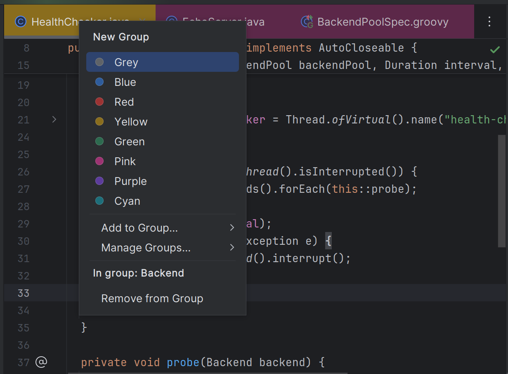

# PrismTabs

Colour-coded tab groups for editor tabs in JetBrains IDEs. Free and open source.

[Install from JetBrains Marketplace](https://plugins.jetbrains.com/plugin/34416-prismtabs) ·
[Manual](https://prismtabs.com/docs) · [Website](https://prismtabs.com)



## Features

- Assign tabs to eight preset colours, each tuned for light and dark editor tabs.
- Create unlimited named groups; rename, recolour and delete them.
- **Files…** lists everything in a group, open or not, and reopens any of it.
- The **PrismTabs** tool window shows every group with its colour and member count, and expands
  each one to its files. Right-click a file to remove it from its group without opening it.
- Hide a group to close its tabs and remember them; show it to reopen them together.
- Mark a group active so newly opened files join it.
- Rename or repaint the presets under **Settings | Tools | PrismTabs**.
- Assignments survive restarts, renames and moves.

Requires IntelliJ Platform 2024.2 or newer. The plugin makes no network calls and collects no data.

## Build and run

Requires a JDK 21 installed; Gradle's toolchain finds it.

```bash
./gradlew test             # unit tests, no IDE needed
./gradlew runIde           # sandbox IDE with the plugin installed
./gradlew buildPlugin      # plugin zip in build/distributions/
./gradlew verifyPlugin     # Plugin Verifier against every supported IDE
```

The end-to-end suite uses [`remote-robot`](https://github.com/JetBrains/intellij-ui-test-robot)
against a sandbox IDE. Start the IDE, then run the tests:

```bash
./gradlew runIdeForUiTests &   # robot server on :8082
./gradlew uiTest
```

On Linux it needs an X11 display.

## Project layout

| Path | Contents |
| --- | --- |
| `src/main/kotlin/io/prismtabs/` | `model` (groups, palette, persisted state), `service`, `provider` (tab colours), `ui` (popup, tool window, settings), `action`, `listener` |
| `src/test/` | Unit tests |
| `src/uiTest/` | `remote-robot` UI tests |
| `scripts/release.sh` | Cuts a release |

## Issues

[Open an issue](https://github.com/prismtabs/prismtabs/issues/new/choose) after checking the
[manual](https://prismtabs.com/docs) and searching existing issues, closed ones included. A 👍 on
an existing issue is how requests are prioritised. Issues are public, so keep personal data out of
them. Send anything private to contact@prismtabs.com, and report suspected security problems as
described in [SECURITY.md](SECURITY.md).

## Contributing

Open an issue before starting a large change. A pull request should pass `./gradlew test` and
`./gradlew verifyPlugin`. Read [CLAUDE.md](CLAUDE.md) for the rules that matter when changing code,
including the platform-API checks and the persisted-state names that must not change.

## Licence

[MIT](LICENSE)
